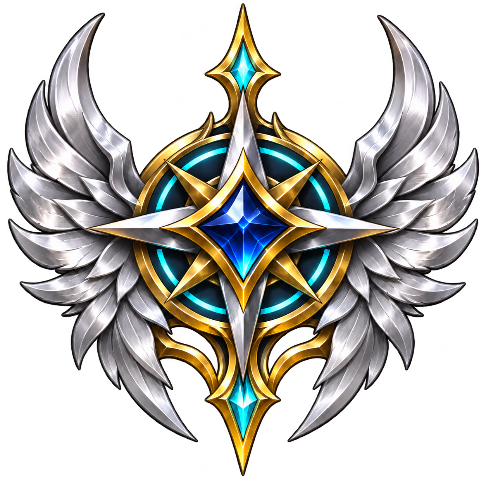
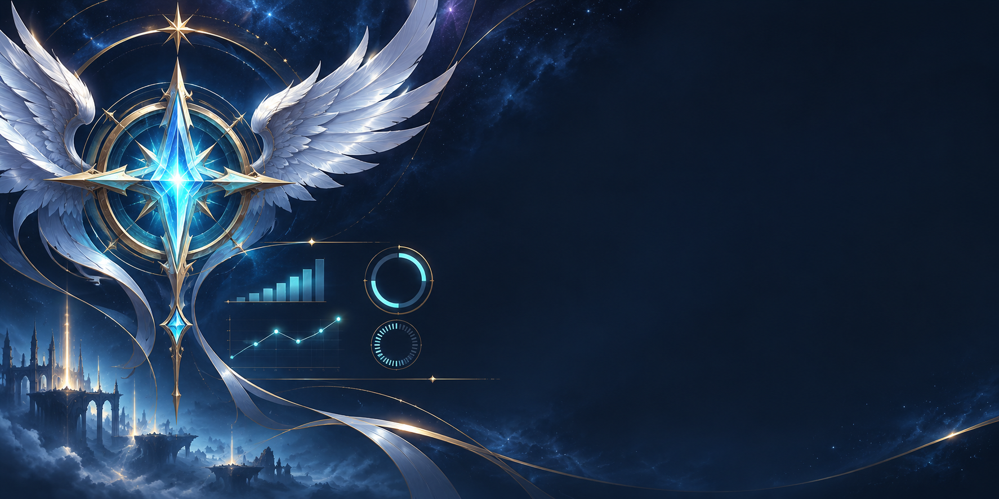

# AION 2 Stats für Elgato Stream Deck

Ein Stream-Deck-Plugin mit zwei Tasten für AION 2:

- **AION 2 CP & Gearscore** zeigt Combat Power, Item Level, Charaktername, Klasse und Level aus dem öffentlichen Charakterprofil. Die Taste aktualisiert sich standardmäßig alle fünf Minuten; ein Tastendruck lädt die Werte sofort neu.
- **Nächstes Shugo-Festival** zeigt den Countdown über dem offiziellen Shugo-Festa-Eingangsicon. Das Icon blinkt in den letzten 30 Sekunden vor dem Start; während der ersten drei Minuten wird die verbleibende Anmeldezeit angezeigt. Die Serverregion ist auswählbar.

## Plugin installieren und einrichten

1. Stream Deck 7.1 oder neuer öffnen.
2. [AION 2 Stats mit einem Doppelklick installieren](release/AION-2-Stats-0.2.4.0.streamDeckPlugin). Stream Deck fragt gegebenenfalls nach, ob das Plugin installiert werden soll.
3. **AION 2 CP & Gearscore** auf eine Taste ziehen.
4. Für die Statistiken im Einstellungsbereich Charaktername und Region eintragen. Falls der Name mehrfach vorkommt, zusätzlich den Server setzen. Die Shugo-Taste kann unabhängig davon verwendet werden.

Node.js 24 und `npm install` werden nur benötigt, wenn du den Quellcode selbst bauen möchtest.

## Aus dem Quellcode bauen

1. Node.js 24 installieren.
2. In diesem Ordner `npm install` ausführen.
3. `npm run package` baut das Plugin und aktualisiert automatisch die fertige Installationsdatei in `release/`.

Weitere Befehle: `npm run build` kompiliert das Plugin; `npm run watch` baut bei Änderungen erneut.

## Datenquelle und Grenzen

Das Plugin liest ausschließlich öffentliche Charakterprofile der offiziellen AION-2-Webseite und benötigt keinen Login oder API-Schlüssel. Es greift nicht auf den Spielprozess, Speicher oder Netzwerkverkehr des Spiels zu. Nicht gelistete oder nicht öffentliche Charaktere können nicht angezeigt werden. Die Endpunkte sind nicht als stabile Entwickler-API dokumentiert und können sich ändern.

Der angezeigte Gearscore kommt aus dem offiziellen Profilfeld **Item Level**. Die Aktualisierung hängt davon ab, wann NCSOFT das öffentliche Charakterprofil aktualisiert. Der Shugo-Timer folgt dem veröffentlichten stündlichen Zeitplan; die Anmeldung ist während der ersten drei Minuten offen. Das im Timer verwendete Shugo-Festa-Eingangsicon stammt aus dem vom Nutzer bereitgestellten Spielbild.
